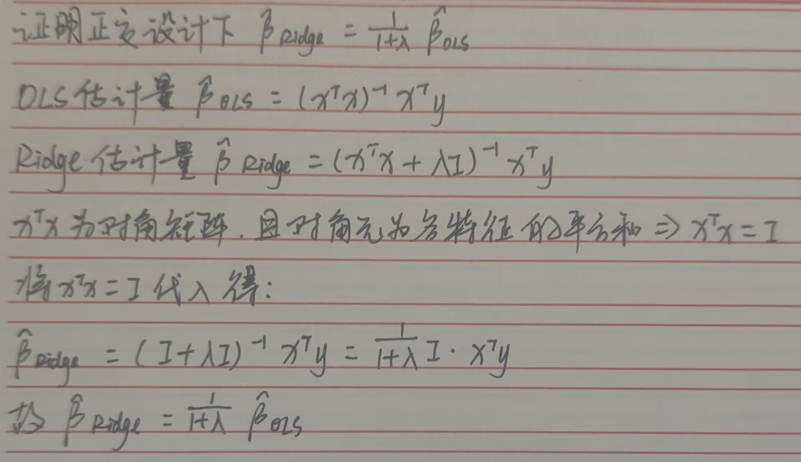

Q1：证明正交设计下 \(\widehat{\boldsymbol\beta}_{\text{Ridge}}=\frac{1}{1+\lambda}\widehat{\boldsymbol\beta}_{\text{OLS}}\)

Q3：为什么正则化前必须 Z-score 标准化？不做的后果？
原因：Z-score标准化可以把所有特征统一变换为均值为0方差为1的分布，让所有特征的系数处于同一量纲尺度下，保证正则化惩罚对每个特征是公平的
后果：正则化项是对系数大小施加惩罚，而特征的量纲会直接对应系数的数值大小，量纲小、取值范围大的特征会算出绝对值很大的系数，被正则化项过度惩罚，反之量纲大的特征系数小，几乎不会被惩罚，导致无法通过系数大小判断特征对目标的影响程度